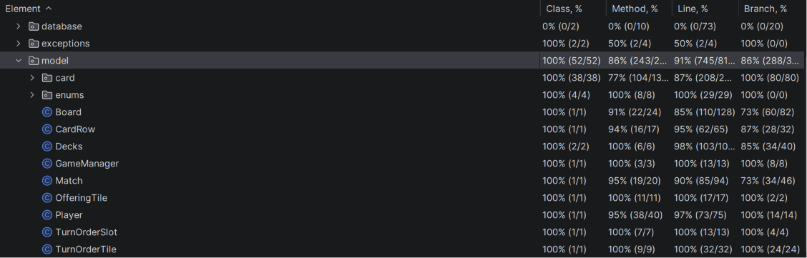

# Software Engineering Final Project - Mesos Report

## 1. Implemented Features vs. Requirements

| Requirement                  | Description                                                                                                                                                                                                                                                                                                             | 
|:-----------------------------|:------------------------------------------------------------------------------------------------------------------------------------------------------------------------------------------------------------------------------------------------------------------------------------------------------------------------| 
| Complete Rules               | The project implements the complete rules from the game                                                                                                                                                                                                                                                                 | - |
| TUI                          | Text-based user interface that allows users to execute game actions and interact with the game state directly via command-line inputs                                                                                                                                                                                   | 
| GUI                          | A graphical user interface featuring real-time feedback                                                                                                                                                                                                                                                                 |  
| Socket                       | The socket protocol establishes a stream-based connection enabling data exchange through leveraging custom-defined DTOs and a predefined message format                                                                                                                                                                 | 
| RMI                          | The RMI protocol enable client-server communication through the use of stubs and skeletons                                                                                                                                                                                                                              |  
| Database Leaderboard         | A persistent global leaderboard system that aggregates match records based on player count, utilizing a `PostgreSQL` database to ensure data durability and accessibility across game sessions                                                                                                                          | 
| Resilience to Disconnections | In the event of a disconnection during a two-player match, the game state is paused. If the disconnected player fails to reconnect within a two-minute window, the match is terminated. For matches with more than two players, the game continues, and the disconnected player's totem remains on the turn order tile  | 

---

## 2. Division of Labor
The entire team collaborated on the initial design and architectural choices. While we divided the implementation tasks for efficiency, we consulted each other to discuss and finalize all core logic aspects together.

| Member Name | Area of Responsibility                                                                                                                                                               | 
| :--- |:-------------------------------------------------------------------------------------------------------------------------------------------------------------------------------------|
| Simone | Model: Card implementation, `Decks`, `Match`, `Board`   Controller:Server/client  Network: socket/RMI implementation   Tui   DB implementation                           |  
| Gaia| Model: `Player`, `OfferingTile`, `CardRow`, `Board`    ClientController and Client for Gui implementation    Gui implementation                                             |  
| Giacomo | Model: `TurnOrderSlot`,`TurnOrderTile`,`Match`,`Board`, `GameManager`    Controller:Server/client    Network: socket/RMI implementation   Tui Logic   Player Persistance |  

---

## 3. Implementation Choices and Design Patterns Used

### 3.1 Design Patterns Used
* **MVC**: The architecture is structured around the model-view-control pattern, which separates the internal game logic (`Model`) from the user interface representations (`View`) and the coordination logic (`Controller`)
*  **Factory**: Used to centralize card instantiation. This approach enforces structural consistency while delegating the specific implementation of card effects to concrete subclasses
* **Observer**: Used to push game-state updates to every client without the controller knowing the underlying transport. The `Server` keeps a registry (`Map<String, VirtualView>`) of the connected clients' `VirtualView`s, which act as the observers; a client subscribes on `connect` through `registerRmi`/`registerSocket`. Whenever the game state changes, the `ServerController` notifies all subscribers via its `broadcast`/`broadcastExcept` helpers, which iterate over the registry and invoke the matching `onXxx` event method on each `VirtualView`. Since RMI stubs and the `Socket_VirtualClient` are interchangeable `VirtualView` implementations, the notification logic stays protocol-agnostic.
* **Visitor**: Used to decouple the socket message transport logic from the game business logic by defining a `Visitor` interface with a `visitXxx` method for every specific message type. On the server, `Socket_ClientHandler` implements this interface, allowing it to receive a polymorphic `ClientToServerMessage`, call its `accept(this)` method, and automatically dispatch execution to the correct handler method in the `ServerController`. The same logic applies on the client, where `Socket_Client` implements the `ServerToClientMessage.Visitor` interface to route incoming network packets to the `ClientController`
* **State Pattern**: implemented server-side in the `controller.server` package, where the current game phase is encapsulated into distinct `PhaseLogic` classes. The `ServerController` holds a `PhaseLogic` field and changes its behavior dynamically.
* **Singleton**: Used in 
	* `DatabaseManager`: It's used to centralize database resource management and prevent thread-safety issues caused by multiple, uncoordinated connections by providing a single, controllable access point for infrastructure operations

### 3.2 Architectural Choices
* **TUI**: The implementation is split between two main components: `TuiPrinter` is a utility class whose purpose is to output formatting, it doesn't perform any I/O operation, `TuiView` handles the input/output flow, it interacts directly with the user via console.
* **VirtualServer/VirtualView**: The  interfaces act as a communication abstraction layer, decoupling the game logic from the underlying network protocols. By defining a unified contract for both RMI and Socket implementations, it ensures that the protocols are fully interchangeable.
* **GUI**: The implementation is split into two main logical areas: the FXML Controllers are responsible for updating the visual components and listening for direct user inputs, while 'GuiView' acts as the central mediator that implements the core View interface, coordinating the windows and managing the asynchronous communication between the background network thread and the UI.
---

## 4. Communication Protocols

At startup the client lets the user choose Socket or RMI. Whichever is picked, the rest of the code talks to it through the same two interfaces, `VirtualServer` (client → server calls) and `VirtualView` (server → client events). The server starts both transports at once, an RMI registry and a `ServerSocket` listener, and saves every connected client in one central map keyed by nickname.

When the game state changes, the `ServerController` sends the update through its `send` method, which delivers it differently depending on the client. Socket clients are written to directly and synchronously, while each RMI client gets its own single-thread executor. That single thread keeps every event for that client in the order it was sent, avoiding race conditions. The server also runs a background heartbeat timer that periodically pings every client to detect silent disconnections.

* **RMI:** The `Rmi_Server` is published as a remote stub. When a client calls one of its methods, the RMI runtime runs that call on the server and forwards it to the `ServerController`, which sends updates back through the client's `VirtualView`. At connection time the `Rmi_Client` hands its own stub to the `Rmi_Server`, which registers it and forwards it to the `ServerController`; this lets the server push game events straight to that client's `ClientController`.
* **Socket:** The socket layer is message-based and uses the Visitor pattern, so client and server never touch the TCP stream directly. On the client, the `Socket_VirtualServer` turns each action into a `ClientToServerMessage` object and writes it to the socket through a synchronized `ObjectOutputStream`. The `Socket_Client` runs a daemon reader thread that keeps reading incoming `ServerToClientMessage` objects; for each one it calls `accept`, which (as a Visitor) routes it to the right method in the `ClientController`. On the server, the `Socket_Server` accepts TCP connections and starts one `Socket_ClientHandler` thread per client. That handler reads `ClientToServerMessage` objects and calls the matching method on the `ServerController`.

---

## 5. Test Coverage Percentages
The project is tested through exhaustive unit and integration testing, focusing on handling of game mechanics, edge cases, and state transitions.

Model (it.polimi.ingsw.model) Coverage : [100]%

