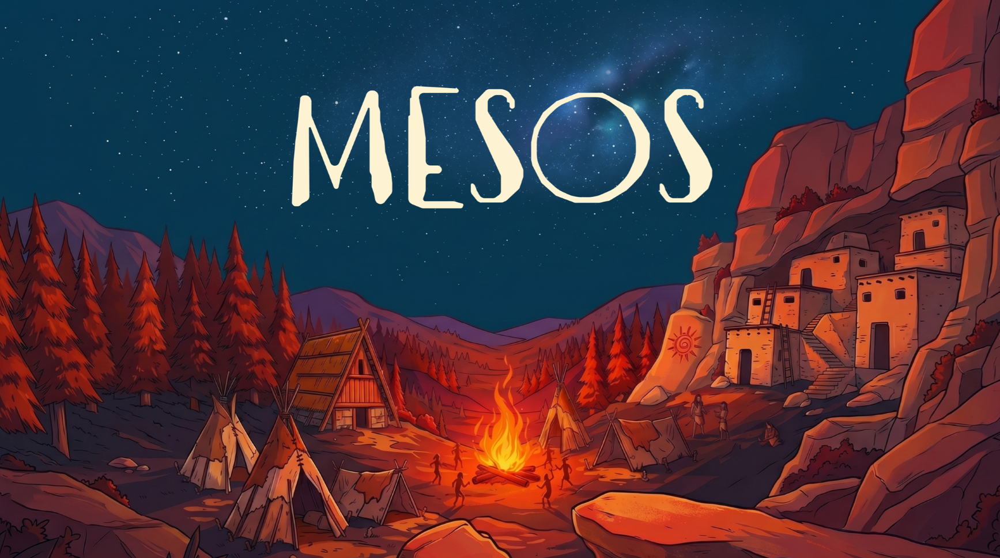

# Software Engineering Final Project - AY 2025-2026


## Implementation of the Mesos Board Game

The project consists of the implementation of a distributed system composed of a server managing matches and data persistence, up to 5 clients can participate in the game, the project follows the **MVC (Model-View-Controller)** architectural pattern.
Networking is handled through the combined and parallel use of both **RMI** and **Socket** protocols.

Interaction and gameplay are supported via both a command-line text interface (**TUI/CLI**) and a graphical user interface (**GUI**).

### Synopsis
> Thousands of years ago, a new era was dawning for humankind. The nomadic hunter-gatherers who had painstakingly earned their place on earth organized themselves into small groups, differentiating social roles, building the first settlements, and starting a great revolution.
>
> Step into the shoes of a tribal leader, carefully choose which jobs to assign to the people joining your tribe, build specialized buildings, and wisely prepare for the events you will face, guiding your tribe to victory!
>
> Place your totem on the Offering Track, then follow its order to take Character or Building cards and use their effects. Choose your position carefully: you can choose before the other players and take fewer cards, or choose later but take more!

---


## Execution
This project requires **JDK 23** or higher to run correctly.

### How the JARs Were Compiled

The JARs are built with the **Maven Shade Plugin**, which packages the project together with all of its dependencies (JavaFX, ControlsFX, Gson, PostgreSQL/JDBC) into two standalone, executable "fat" JARs. A single command produces both artifacts. From the `Mesos/` directory (the module containing the `pom.xml`), run:

```
mvn clean package
```

The compiled JARs are placed in the `Mesos/target/` directory:

| JAR | Entry point (`Main-Class`) |
| :--- | :--- |
| `mesos-server.jar` | `it.polimi.ingsw.Server` |
| `mesos-client.jar` | `it.polimi.ingsw.Client` |

### How to Run the Project From JARs

Run the commands below from the `Mesos/target/` directory (or prefix the JAR names with their path).

#### Server

The server has no arguments and listens on the default ports (RMI `1234`, Socket `8080`):

```
java -jar mesos-server.jar
```

#### Client

The client takes the **server's IP address** as an optional first argument. With no argument it defaults to `localhost` (single-machine runs); on separate machines, pass the server's IP. The protocol (`socket`/`rmi`) and interface (`tui`/`gui`) are then chosen interactively at startup.

```
# Same machine as the server (defaults to localhost)
java -jar mesos-client.jar

# Different machine: connect to the server's IP address
java -jar mesos-client.jar 192.168.1.50
```

Replace `192.168.1.50` with the actual LAN IP of the machine running the server.

> **Notes:**
> - The fat JARs bundle the JavaFX native libraries for the platform on which they are built. The server and the TUI client run on any OS; the **GUI** client must be run on (or rebuilt for) the same platform family used at build time.
> - The **Socket** protocol works across machines with no extra configuration. If **RMI** fails to connect across machines (the server's hostname resolving to a loopback address is the usual cause), start the server with `-Djava.rmi.server.hostname=<server-IP>` so RMI advertises the correct address to clients:

```
java -Djava.rmi.server.hostname=192.168.1.50 -jar mesos-server.jar
```

---

## Implemented Functionalities

| Functionality                  |    Status    |
|:-------------------------------|:------------:|
| Complete Rules                 |      ✅       |
| TUI                            |      ✅       |
| GUI                            |      ✅       |
| Socket                         |      ✅       |
| RMI                            | ✅ |
| Multiple Games                 | ❌ |
| Database Leaderboard           | ✅ |
| Game Persistence               | ❌ |
| Resilience to Disconnections   | ✅ |


---

## Documentation

### UML
The following links display the class diagrams of the project:
- [Detailed UML](link_here)
- [General UML](link_here)

### Coverage Report
The JUnit test coverage report can be viewed at the following link:
- [Test Coverage Report](link_here)

### JavaDoc
The code documentation, compiled according to JavaDoc standards, can be accessed at the following address:
- [Javadoc](link_here)

### Database Dump
The SQL dump file of the database structure can be found at the following link:
- [Database Dump](Mesos/deliverables/final/dump.sql)


---

## Libraries and Plugins

| Library / Plugin | Description |
| :--- | :--- |
| **Maven** | Build automation and dependency management tool for Java projects. |
| **JavaFX (Controls & FXML)** | Framework used for developing and implementing the Graphical User Interface (GUI), including FXML layout support. |
| **ControlsFX** | A collection of high-quality UI controls and useful tools that complement the core JavaFX framework. |
| **Gson** | Java library used for serializing Java Objects into JSON and deserializing JSON strings back into Java Objects. |
| **PostgreSQL / JDBC** | Driver and client for managing persistence and communication with the remote database. |
| **JUnit (Jupiter & v3)** | Testing framework dedicated to writing and running unit tests to ensure code coverage and reliability. |

*Note: For proper execution of the game via TUI, ensure your terminal supports ANSI escape codes for color rendering.*


---

## Group Members

*(Section left blank as requested — Insert names, surnames, student IDs, and GitHub accounts of the team members here prior to final submission)*

---

> ⚠️ **NOTE:** *Mesos is a board game developed and published by Cranio Creations Srl. The graphical assets of this project related to the board game are used with the prior approval of Cranio Creations Srl for educational purposes only. Distribution, copying, or reproduction of the contents and images in any form outside of this project is prohibited, as is the redistribution and publication of the contents and images for purposes other than the aforementioned. Commercial use of said contents is also prohibited.*